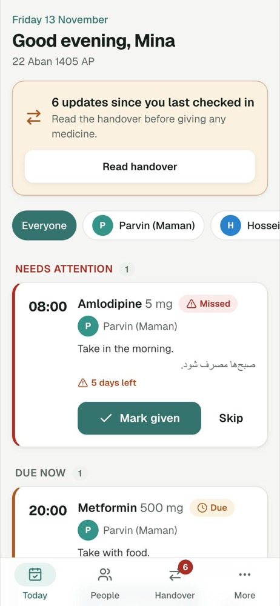
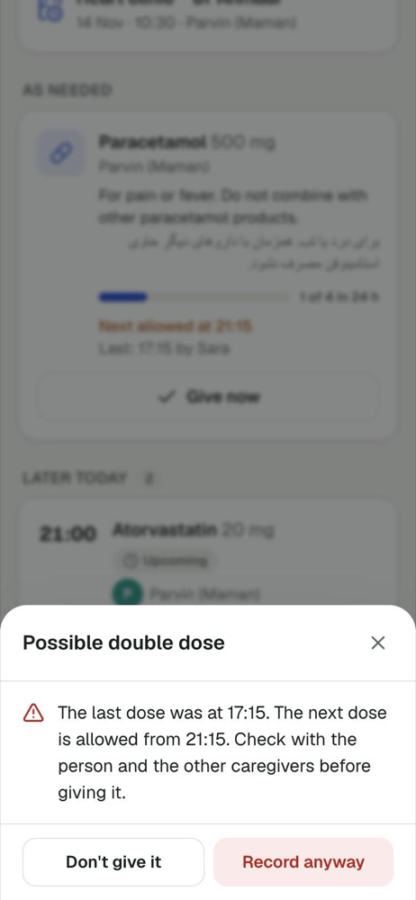
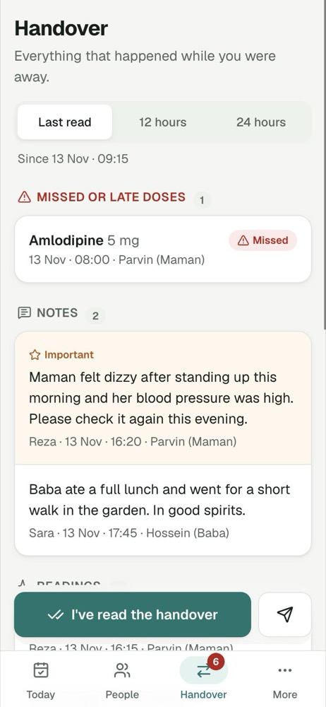
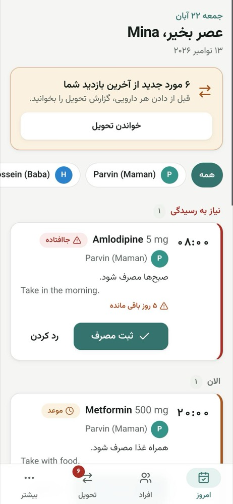
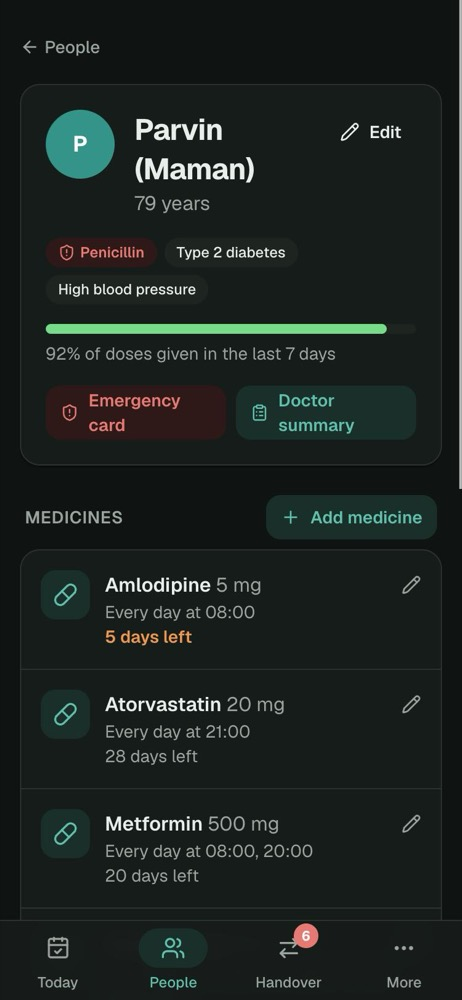
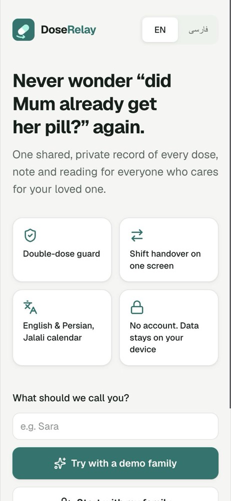

<div align="center">


# DoseRelay

**Safe medicine handovers for family caregivers.**
A private, bilingual (English / فارسی) web app that helps families who share caring duties avoid double doses and hand over clearly between shifts.

[](https://github.com/Mahyadmi/dose-relay/actions/workflows/ci.yml)
[](https://mahyadmi.github.io/dose-relay/)
[](LICENSE)

**[Try the live demo →](https://mahyadmi.github.io/dose-relay/)** (no sign-up: tap *Try with a demo family*)

</div>

---

## The problem

When an elderly parent is looked after by several people (a son, a daughter, a visiting nurse), the most common and most dangerous mistakes are not about remembering medicine. They are about **coordination**:

- **Double dosing:** *"Did Mum already have her 8 pm tablet? I'll give it just in case."*
- **Lost information at handover:** *"Her blood pressure was high this morning,"* and the next person never hears it.
- **A language gap:** in immigrant families the prescription is in English, while the parent or a relative reads Persian.

Most medicine apps are built for **one patient reminding themselves**, need an account, and store health data on their servers. DoseRelay is built for the **caregivers around the patient**, and it keeps the data on their own devices.

## Screenshots

| Today | Double-dose guard | Shift handover |
| :---: | :---: | :---: |
|  |  |  |
| **Persian (RTL, Jalali calendar)** | **Person, dark mode** | **Onboarding** |
|  |  |  |

## Features

**Safety**
- **Double-dose guard.** Before a dose is recorded, DoseRelay checks whether someone already gave it, gave the same medicine less than 2 hours ago, or (for as-needed medicines) whether the minimum gap and 24-hour maximum allow it. If not, it says who gave it and when.
- **As-needed (PRN) timer.** For medicines like paracetamol it shows *"Next allowed at 14:30"* and *"2 of 4 in 24 h"*.
- **Missed and late doses** are highlighted, with colour always paired with an icon and text.
- **Low stock warnings.** Stock goes down with each dose, and the app warns when 7 days or fewer are left.

**Handover**
- **"Since you left" screen:** missed doses, doses given by others, notes (important ones first), readings outside the normal range, appointments in the next 48 hours and medicines running low.
- **Quick notes and readings:** blood pressure, blood sugar, temperature, pulse, oxygen and weight, with trend lines.
- **Encrypted relay links** to share records with another caregiver, without a server (see below).

**Bilingual**
- Full **English and Persian** interface with a proper **right-to-left** layout.
- **Persian (Jalali) calendar** and **Persian digits**, usable in either language. The Today screen always shows both calendars.
- Each medicine has **instructions in both languages**, shown together so a grandparent and a nurse can read the same screen.
- Number fields accept Persian digits (۱۲۳) as well as Latin ones.

**Practical**
- **Emergency card** (allergies, conditions, medicines, contacts) and a **30/90-day doctor summary**, both printable.
- **Calendar reminders:** exports an `.ics` file with a daily alarm for every dose. Your phone's calendar app then reminds you reliably, which web notifications cannot guarantee.
- **Installable** (PWA) and **works offline** after the first visit.
- **Accessible:** large touch targets, adjustable text size, high-contrast mode, dark mode, keyboard support, screen-reader labels and reduced-motion support.
- **Demo family** so anyone can explore every feature in seconds.

## Privacy by design

There is **no account, no backend and no analytics**. All records live in the browser's `localStorage` on the caregiver's own device.

Sharing uses an **encrypted relay link**:

1. The records are compressed and encrypted **in the browser** with **AES-256-GCM**. The key comes from a random share code via **PBKDF2-SHA-256** (210,000 iterations).
2. The encrypted data goes in the link's **fragment** (the part after `#`). Browsers never send the fragment to the web server, so GitHub Pages only ever serves static files.
3. The share code is passed on separately (for example read out over the phone). Without it the link is useless.
4. The receiver can **merge** the records into their own. Records are matched by ID, so importing the same relay twice changes nothing.

All of this uses the browser's built-in Web Crypto API, with no third-party crypto library. See [`src/lib/share.ts`](src/lib/share.ts).

## Tech stack

| | |
| --- | --- |
| Framework | [Next.js 16](https://nextjs.org) (App Router, static export) · React 19 · TypeScript (strict) |
| Styling | Tailwind CSS 4, with design tokens as CSS variables for light, dark and high-contrast themes |
| Internationalisation | Typed message catalogue (TypeScript makes sure every English key has a Persian translation) and `Intl` APIs with `-u-ca-persian` for the Jalali calendar |
| Security | Web Crypto (AES-GCM and PBKDF2), CompressionStream |
| Testing | Vitest, with 29 unit tests on the domain logic |
| CI/CD | GitHub Actions: lint, type-check, test and build, then deploy to GitHub Pages |
| Offline | Web app manifest and a small service worker |

## How the code is organised

```
src/
├── lib/                 Pure, framework-free domain logic (unit tested)
│   ├── doses.ts         Dose slots, states, double-dose guard, PRN rules, stock, adherence
│   ├── handover.ts      "Since you left" summary
│   ├── share.ts         Encrypted relay links
│   ├── ics.ts           Calendar reminder export
│   ├── vitals.ts        Reference ranges and validation
│   ├── format.ts        Dates (Gregorian/Jalali), digits, number parsing
│   ├── i18n.ts          English and Persian messages
│   ├── schema.ts        Validating backups, merging relays
│   ├── store.ts         localStorage store (useSyncExternalStore)
│   └── __tests__/
├── components/          UI building blocks (cards, sheets, forms, toasts)
├── views/               One component per screen
└── app/                 Next.js routes, layout, manifest
```

The important rules (when a dose counts as missed, what makes a double dose, PRN limits) live in plain TypeScript functions that take the current time as a parameter. That makes them easy to test and keeps them separate from React.

## Run it locally

You need Node.js 20 or later.

```bash
git clone https://github.com/Mahyadmi/dose-relay.git
```

```bash
cd dose-relay && npm install
```

```bash
npm run dev
```

Then open http://localhost:3000.

| Command | What it does |
| --- | --- |
| `npm run dev` | Start the development server |
| `npm test` | Run the unit tests |
| `npm run typecheck` | Type-check the project |
| `npm run lint` | Lint the code |
| `npm run build` | Build the static site into `out/` |
| `npm run icons` | Re-generate the PNG app icons from `public/icon.svg` |

## Deployment

Every push to `main` runs the [CI workflow](.github/workflows/ci.yml). If lint, type-check, tests and build all pass, the static site is deployed to GitHub Pages at **https://mahyadmi.github.io/dose-relay/**. The build sets `NEXT_PUBLIC_BASE_PATH` to the repository name so links work under the `/dose-relay/` path.

## Known limitations

These are honest trade-offs of a serverless, privacy-first design:

- **No live sync.** Caregivers share updates by sending a relay link (or a backup file). A real-time version would need a backend with end-to-end encryption.
- **Reminders use the phone's calendar** rather than push notifications, because web push is unreliable on iOS and needs a server.
- **Stock counts can drift** if two caregivers record doses offline and then merge, because the latest copy of a medicine wins.
- Reference ranges for readings are general adult values, used only to highlight a reading for the next caregiver.

## Roadmap

- [ ] End-to-end encrypted live sync between a family's devices
- [ ] Drug interaction check
- [ ] Voice logging ("gave Maman her heart tablet")
- [ ] More languages (Arabic, Turkish, Urdu)
- [ ] End-to-end browser tests with Playwright

## Disclaimer

DoseRelay helps caregivers keep records and coordinate. **It does not give medical advice.** Always follow the instructions of the prescriber and pharmacist, and call emergency services in an emergency. The demo family, names and phone numbers are fictional (the phone numbers use the UK's reserved drama range).

## Licence

[MIT](LICENSE) © 2026 Mahyad Mirzabagheri
